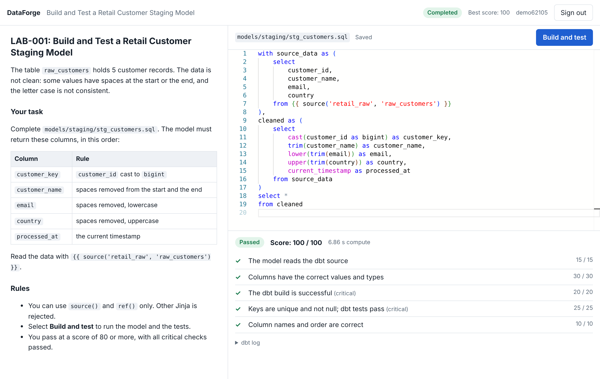

# DataForge

Guided data engineering labs in the browser. A learner opens a lesson, writes
a dbt model, runs it, and gets an automated grade. No local setup.



This repository holds the **fast-path vertical slice**: one lesson (LAB-001)
that runs end to end on DuckDB, with no cloud account. The same lesson can
run on Azure Databricks: see [docs/databricks.md](docs/databricks.md).

- Original specification: [docs/spec/dataforge-v1.0-original.md](docs/spec/dataforge-v1.0-original.md)
- Decisions that changed it: [docs/spec/fast-path.md](docs/spec/fast-path.md)

## Run it

```bash
docker compose up --build
```

Open http://localhost:3000, type a name, and select **Build and test**.

## Deploy it

A test deployment on Render: see [docs/deploy.md](docs/deploy.md).

## Run it without Docker

```bash
cd apps/api
python -m venv .venv && .venv/bin/pip install -e ".[worker,dev]"
.venv/bin/uvicorn dataforge.main:app_factory --factory --port 8000
```

```bash
cd apps/api
.venv/bin/python -m dataforge.worker
```

```bash
cd apps/web
npm ci && npm run dev
```

Without `DATABASE_URL`, the API and the worker use a SQLite file in
`apps/api`. Start them from the same directory.

## Test it

```bash
cd apps/api && .venv/bin/pytest -q
```

The suite runs real dbt against DuckDB. It takes about 1 minute.

```bash
scripts/smoke.sh http://localhost:8000
```

The smoke script needs a running stack.

## How it works

```text
Browser (Next.js + Monaco)
  └── API (FastAPI): identity, lessons, files, execution requests
        └── Postgres: state and the job queue (table `executions`)
              └── Worker: trusted dbt handlers + independent grader
                    └── DuckDB file in a temporary workspace, deleted after each run
```

| Path | Contents |
|---|---|
| `apps/api/dataforge/` | API, worker, runner, grader, SQL guard |
| `apps/api/dataforge/backends/` | Execution backends: DuckDB and Databricks |
| `apps/web/` | Workbench UI |
| `curriculum/retail-lakehouse/lab-001/` | Lesson manifest, instructions, trusted dbt project, starter, solution |
| `.github/workflows/ci.yml` | Lint, tests, web build, full-stack smoke test |

## Security rules in this slice

- With `DF_AUTH_MODE=jwt`, the API accepts only tokens that the identity provider signed (asymmetric keys, issuer, audience, and expiry are checked).
- The learner sends an operation id (`dbt_build`). No learner text goes into a command.
- The learner can write only the files in `editable_files`. `profiles.yml`, tests, and macros are trusted.
- Learner SQL can use `source()` and `ref()` only. `env_var()` and all other Jinja are rejected.
- A model must be one query, and it can read only `source()` and `ref()` relations.
- dbt gets a minimal environment. Worker variables do not reach it.
- Learner SQL runs with DuckDB file access off.
- The grader opens the result read-only and calculates expected values itself.
- Reference solutions are not in the runtime images (`.dockerignore`).

## Not done yet

- **Email-link test by a person.** Token sign-in is proven against the real Supabase project at the API (see [docs/auth.md](docs/auth.md)). The email link is not yet tested by a person. Without a `.env` file, the stack uses the development sign-in: do not put that on a public host.
- **Databricks live proof.** The Databricks backend is not yet run against a real workspace.
- **Migrations.** Tables are created at startup. Add Alembic before the schema changes.
- Monthly quotas, Tier B (Terraform labs), SSE log streaming.
