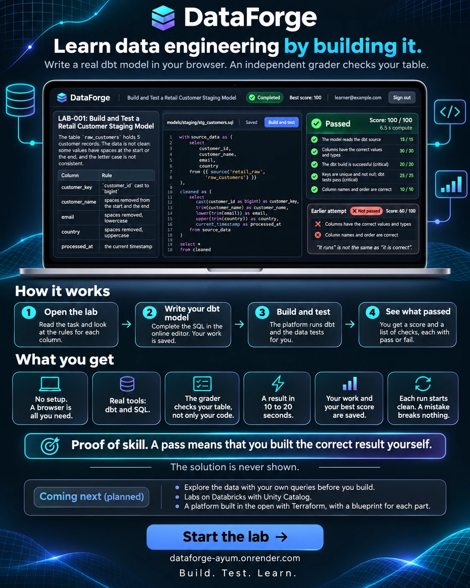

# Marketing material

| File | Contents |
|---|---|
| [flyer.webp](flyer.webp) | The accepted flyer for the portal, version of 15 November 2026 |
| [flyer-brief.md](flyer-brief.md) | The design brief that the flyer follows |

## The flyer

- **Format:** portrait, 1122 x 1402 px, WebP.
- **Accepted:** 15 November 2026.
- **Source of truth:** the flyer shows the portal as it is on that date. Each part is checked against the code below.

## Status: do not publish yet

The flyer is accepted as a design. It is not ready for the public, for 2 reasons:

1. **Sign-in does not work on the live portal.** The button "Start the lab" sends people to `dataforge-ayum.onrender.com`, and they cannot sign in. 3 settings in the Supabase project are open: see [../auth.md](../auth.md).
2. **The live portal is the free, single-container test deployment.** It is for a small number of trusted people: see [../deploy.md](../deploy.md).

Publish the flyer when sign-in works and a person has completed the lab on the live portal.

## What the flyer shows, checked against the code

| Part of the flyer | Agrees with the product? | Source |
|---|---|---|
| Top bar: lesson title, "Completed", "Best score: 100", email, "Sign out" | Yes | `apps/web/app/workbench.tsx` |
| No menu | Yes. The portal has no menu | `apps/web/app/workbench.tsx` |
| Task text and the table of 5 column rules | Yes | `curriculum/retail-lakehouse/lab-001/instructions.md` |
| File name `models/staging/stg_customers.sql`, "Saved", "Build and test" | Yes | `apps/web/app/workbench.tsx` |
| The SQL in the editor | Yes. It is a correct model that the SQL guard accepts | `apps/api/dataforge/guard.py` |
| "Passed", "Score: 100 / 100", "6.5 s compute" | Yes, for a correct model | `apps/api/dataforge/grader.py` |
| The 5 checks and their points: 15, 30, 20, 25, 10 | Yes | `apps/api/dataforge/grader.py` |
| "Earlier attempt": not passed, 60 of 100, 2 failed checks | Yes. This is the result of the starter file | `apps/api/tests/test_lesson_e2e.py` |
| "A result in 10 to 20 seconds" | Yes on the free deployment. About 7 seconds in local tests | Test runs |
| "Your work and your best score are saved" | Yes | `apps/api/dataforge/db.py` |
| "Each run starts clean" | Yes. Each run gets a new workspace, deleted after the run | `apps/api/dataforge/worker.py` |
| "The solution is never shown" | Yes. Solutions are not in the runtime images | `.dockerignore`, CI |
| "Coming next (planned)": queries, Databricks, Terraform | Correctly labelled as planned | [../spec/platform-proof-track.md](../spec/platform-proof-track.md) |

## Differences from the real portal

These are small. They do not make a false claim, but correct them in a next version.

1. **Backticks show as text.** The flyer shows `` `raw_customers` `` and `` `customer_id` cast to `bigint` `` with the backtick characters. The portal shows these words in a code style, with no backticks.
2. **The layout has 3 columns.** The real portal has 2: the task on the left, and the editor above the result on the right. The 3-column layout is a design choice for the flyer.
3. **"Earlier attempt" is not a panel in the portal.** The portal shows 1 result at a time. The inset on the flyer puts 2 runs together to make the point. The proposed lab format (explore, build, prove) has a list of all runs.
4. **The line numbers in the editor skip.** Lines 8 and 9 have a wrapped line and a dot between them.
5. **The result panel has a large "Passed" with an icon.** The portal shows a small green badge.

## Rules for the next version

- A change to the flyer must keep the "do not show or say" list in [flyer-brief.md](flyer-brief.md).
- Move an item out of "Coming next" only when it runs live and the evidence is in the repository. This is Rule 1 of the platform track: proof before publication.
